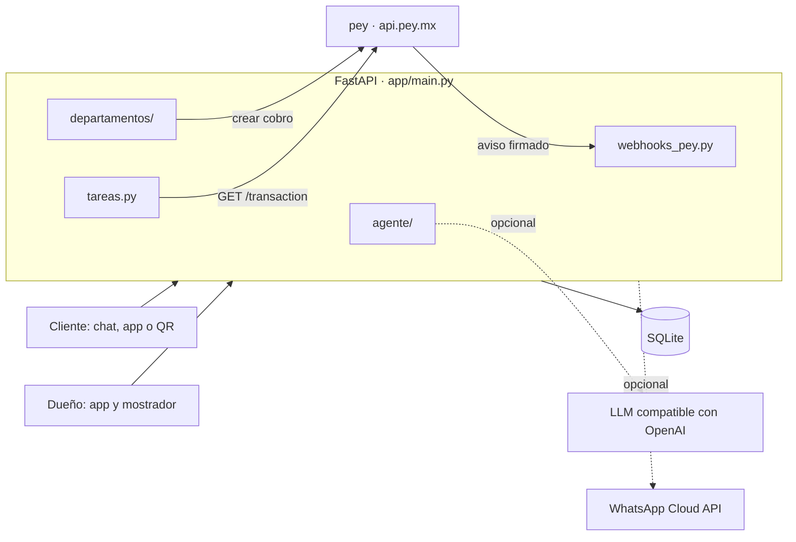
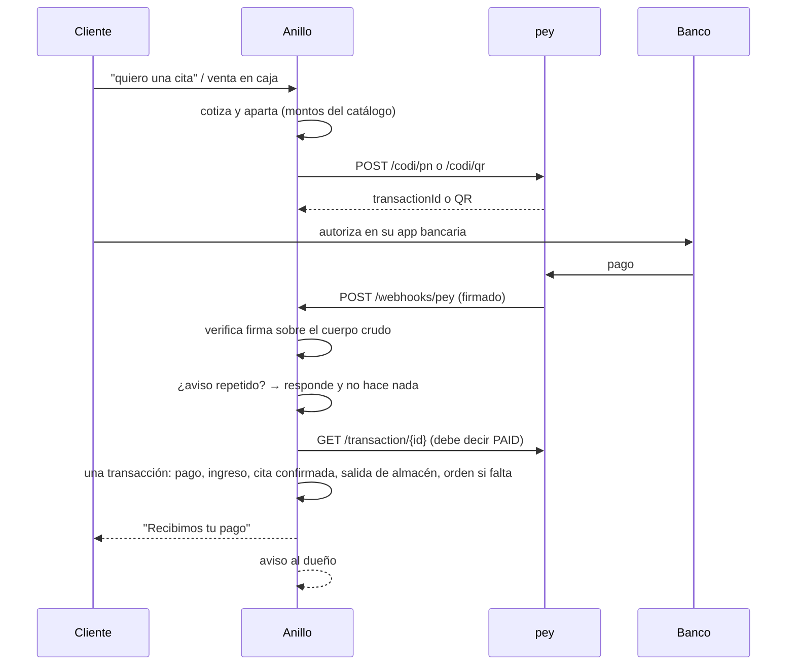

# Arquitectura de Anillo

Un solo servicio en Python (FastAPI) con SQLite. Las pantallas son HTML y JavaScript sin framework, servidas por el mismo servicio. La app Android es una envoltura de la app web.

## Componentes



| Pieza | Archivo | Responsabilidad |
|---|---|---|
| Rutas | `app/main.py` | Entradas HTTP. Valida la llave (`?k=`) y la sesión |
| Portada | `app/portada.py` | Explica el prototipo y lleva a las tres puertas |
| Agente | `app/agente/` | Entiende el mensaje y llama herramientas. Con LLM si hay llave; si no, respuestas guiadas (`fallback.py`) |
| Departamentos | `app/departamentos/` | Agenda, cotizaciones, cobranza, almacén, cargas, facturas, impuestos, libro, memoria |
| pey | `app/pey.py` | Cliente HTTP: QR, aviso al banco, liga y consulta de transacciones |
| Pagos | `app/webhooks_pey.py` | Firma, deduplicación y efectos de un pago confirmado |
| Tareas | `app/tareas.py` | Recordatorios, vencimientos y conciliación de avisos perdidos |
| Seguridad | `app/seguridad.py` | Cuentas, sesiones, cara, huella, correo, bloqueo por intentos |
| Tablero | `app/tablero.py` | Arma lo que ve cada pantalla según el rol |
| Datos | `app/db.py` | Esquema y transacciones |

## Reglas del dinero

1. El dinero se guarda en **centavos enteros**. Solo se convierte a pesos al llamar a pey o al mostrar.
2. **Solo el servidor marca un pago:** por el aviso firmado de pey o por la consulta a `GET /transaction/{id}`. La pantalla solo observa.
3. El agente **no calcula montos ni decide pagos**. Los montos salen del catálogo y de la base de datos.
4. Un pago se aplica **una sola vez**: `webhook_eventos` reconoce el aviso repetido y `pagos.pey_transaction_id` es único.

## Recorrido de un pago



Si el aviso no llega, `tareas.py` consulta a pey los cobros pendientes y aplica el pago por la misma función (`procesar_transaccion_confirmada`).

## Estados de un cobro

```
pendiente ── pago ──▶ pagado
pendiente ── vence y pey confirma que no se pagó ──▶ expirado
expirado  ── llega el pago ──▶ pagado (marcado como tardío)
```

Efectos al pagar: ingreso en el libro; si era anticipo, la cita pasa a confirmada; si se liquida la cotización, se genera la factura en borrador; si salió mercancía, se consumen los lotes más viejos y se propone la orden al proveedor cuando algo queda bajo el mínimo.

## Datos principales

- **Personas y chat:** `contactos`, `mensajes`, `cuentas`, `sesiones`, `caras`, `credenciales_bio`.
- **Venta:** `cotizaciones`, `citas`, `ventas`, `venta_lineas`.
- **Dinero:** `cobros`, `pagos`, `webhook_eventos`, `movimientos`, `facturas`.
- **Almacén:** `productos`, `lotes`, `movimientos_almacen`, `facturas_compra`, `recetas`, `atendidos`, `proveedores`, `ordenes_compra`, `orden_lineas`, `cargas`.
- **Persona:** `gastos_personales`, `metas_ahorro`, `consumos`, `favoritos`, `resenas`.

## Almacén

- Cada entrada abre un **lote** con su precio de llegada. Las salidas consumen primero el lote más viejo.
- La carga acepta el Excel de la tienda (`.xlsx`, `.csv`), la factura (`.xml` CFDI o `.pdf`) y una foto de la lista. El Excel y el XML se leen sin LLM. La foto y el PDF necesitan un LLM con visión, y nunca se inventan precios ni piezas: lo que no se lee, no entra.
- Los artículos se acomodan por grupo y el tablero muestra el valor del inventario a precio de llegada.

## Seguridad

- Las rutas de la API piden la llave del equipo (`PANEL_KEY`) y, en la app, una sesión (`X-Anillo-Sesion`).
- Entrada con cara, huella o correo. Se bloquea tras varios intentos fallidos y se guarda bitácora.
- El personal ve cantidades. No ve costos, márgenes ni finanzas.
- Los secretos van en `.env`, que no se sube al repositorio.

## Qué es simulado

El banco de la mesa (`/simulacion`), el timbrado del CFDI (borrador, sin PAC ni CSD) y la estimación de impuestos. Las devoluciones son manuales porque la API de pey no reembolsa. Todo se dice en pantalla.
