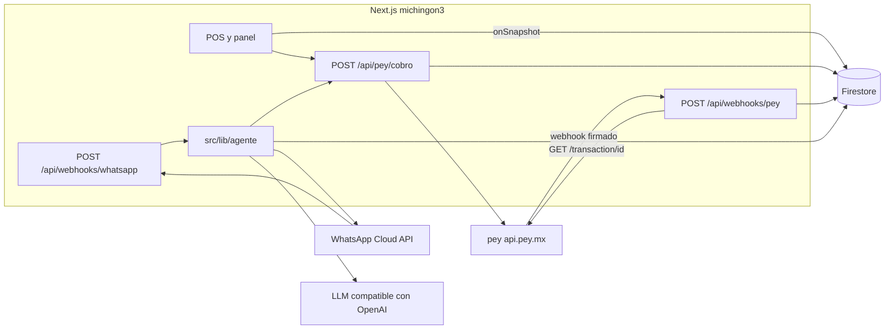
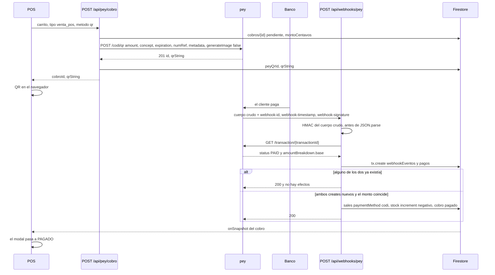
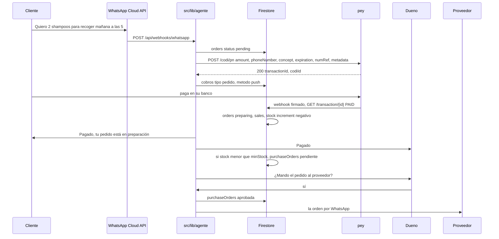

# Arquitectura — Michingón con pey y agente nuevo

Versión de referencia: `v3.2-construir`. La app que se modifica es `michingon3/` (Next.js 14, TypeScript, Firebase), en vivo en `https://michingon3-a77f8.web.app`.

De Michingón se usa la arquitectura: módulos, Firestore, pantallas, roles y despliegue. No se usa su IA (`src/ai/`, Genkit, escáneres, `brain`, `ai-assistant-widget`, `mao-assistant`). El agente de WhatsApp es nuevo y vive en `src/lib/agente/`. Llama a nuestro LLM con el cliente `openai` (`LLM_BASE_URL`, `LLM_API_KEY`, `LLM_MODEL`). Donna (`referencia_cerberus/salon_almacen`) se porta a TypeScript en la fase M5; no se importa el Python.

El dinero del cobro se guarda en **centavos enteros** (`montoCentavos`). pey recibe `amount` en pesos, y solo en el momento de la llamada. Una venta queda pagada solo si el webhook firmado pasa y `GET /transaction/{id}` responde `status: PAID` con el mismo monto. El LLM no calcula montos ni marca pagos.

## 1. Componentes

| Pieza | Responsabilidad |
|---|---|
| POS | Arma el carrito. "Cobrar con CoDi" crea el cobro. El modal solo escucha el documento. |
| `POST /api/pey/cobro` | Usuario autenticado del negocio. Crea `cobros` y llama a pey. |
| `POST /api/webhooks/pey` | Lee el cuerpo crudo, verifica la firma y procesa el pago. |
| Firestore | Negocio, ventas, stock, cobros, pagos, pedidos, órdenes de compra. |
| pey | `POST /codi/qr`, `POST /codi/pn`, `POST /payment-link/create`, `GET /transaction/{id}`. |
| WhatsApp Cloud API | Entra el mensaje del cliente y salen los avisos. El envío real es la fase M3. |
| LLM | Solo redacta y elige tools. No toca dinero. |

## 2. Archivos dentro de `michingon3/`

Lista de `MICHINGON.md` §4. Lo marcado M1 ya está en este árbol. El resto se construye en M2–M5 y no se adelanta aquí.

| Archivo |  |
|---|---|
| `src/lib/server/firebase-admin.ts` | Nuevo. M1. |
| `src/lib/pey.ts` | Nuevo. M1. |
| `src/lib/pey-webhook.ts` | Nuevo. M1. |
| `src/lib/whatsapp.ts` | Nuevo. M3. |
| `src/app/api/pey/cobro/route.ts` | Nuevo. M1. |
| `src/app/api/webhooks/pey/route.ts` | Nuevo. M1. |
| `src/app/api/pey/conciliar/route.ts` | Nuevo. M4. |
| `src/app/api/webhooks/whatsapp/route.ts` | Se modifica. Deja de llamar a `src/ai/`. M3. |
| `src/lib/agente/llm.ts` | Nuevo. M3. |
| `src/lib/agente/herramientas.ts` | Nuevo. M3. |
| `src/lib/agente/prompts.ts` | Nuevo. M3. |
| `src/ai/**` | No se toca. |
| `src/components/pos/CodiCheckoutModal.tsx` | Nuevo. M1. |
| `src/app/(app)/business/[id]/pos/page.tsx` | Se modifica. Botón "Cobrar con CoDi". M1. |
| `src/components/dashboard/codi-live-widget.tsx` | Nuevo. M4. |
| `src/types/business.ts` | Se modifica. M1. |
| `src/contexts/DataContext.tsx` | Se modifica. `addSale` persiste el stock. M1. |
| `firestore.rules` | Se modifica. `cobros` y `pagos` solo los escribe el servidor. M1. |
| `package.json` | Se agrega `qrcode` para dibujar el QR en el navegador. |

En M5, sin estar en esa lista, se agregan `src/lib/server/inventario.ts` y `src/lib/server/recetas.ts` al portar a Donna.

Antes de cada deploy a Firebase hay que copiar `src/` sobre `functions/src/`. Esa copia está desfasada (38 archivos) y un deploy sin sincronizar sube código viejo.

## 3. Firestore

Lo que ya escucha el panel, en `businesses/{bid}/`: `products`, `sales`, `expenses`, `clients`, `employees`, `assets`, `suppliers`, `invoices`, `orders`.

Lo que se agrega. Lo escribe solo el Admin SDK.

### `businesses/{bid}/cobros/{cobroId}`

| Campo | Valores |
|---|---|
| `tipo` | `anticipo` \| `saldo` \| `pedido` \| `venta_pos` \| `libre` |
| `metodo` | `push` \| `qr` \| `link` |
| `montoCentavos` | entero |
| `concepto` | string |
| `estado` | `pendiente` \| `pagado` \| `expirado` \| `fallido` \| `cancelado` |
| `clienteId`, `telefono10`, `orderId` | opcionales |
| `saleDraft` | `{ products: SaleItem[], total, clientId? }` para armar la venta al pagar |
| `peyTransactionId`, `peyCodiId`, `peyQrId`, `peyLinkId`, `qrString`, `linkUrl` | opcionales, según el método |
| `expiraEn` | Timestamp |
| `pagadoEn` | Timestamp, opcional |
| `pagoTardio` | boolean |
| `recordatorios` | number |
| `creadoEn` | Timestamp |

### `businesses/{bid}/pagos/{peyTransactionId}`

El id del documento es el `transactionId`.

| Campo | |
|---|---|
| `cobroId` | string o `null` si no se concilió |
| `montoCentavos` | entero |
| `tipoEvento` | `codi.pn.payment_received`, `codi.qr.payment_received`, u otro `type` que traiga `transactionId` |
| `payload` | cuerpo del evento |
| `recibidoEn` | Timestamp |

### `webhookEventos/{webhook-id}`

Colección raíz. Solo `recibidoEn`. El cliente no la lee ni la escribe.

### `businesses/{bid}/purchaseOrders/{id}`

| Campo | |
|---|---|
| `supplierId` | string. En M1 queda vacío: `Product` no trae proveedor. M5 lo llena al decir "sí". |
| `items` | `{ productId, cantidad, costoUnit }[]` |
| `estado` | `pendiente` \| `aprobada` \| `enviada` \| `recibida` \| `rechazada` |

### `businesses/{bid}/conversaciones/{telefono10}/mensajes/{id}`

Historial del agente. Lo escribe M3.

`Order` gana `confirmada?: boolean` para el anticipo. `Sale.paymentMethod` acepta `'codi'`. Los precios de `products` y `sales` siguen en pesos, como ya están en Michingón. El centavo vive en `cobros` y `pagos`.

## 4. Escena A — mostrador

El `GET` va antes de escribir la idempotencia. Si se creara el pago y la consulta todavía no dijera `PAID`, el reintento encontraría el documento y ya no podría registrar la venta.

El botón de efectivo sigue usando `addSale`. Ese camino también hace `increment(-cantidad)` en Firestore. CoDi no llama a `addSale`: la venta y el stock los escribe el webhook, una sola vez.

## 5. Escena B — WhatsApp

El código de esta escena es M3 y M5. El webhook de M1 ya deja el pedido en `preparing`, descuenta stock y, si el producto queda bajo `minStock`, crea `purchaseOrders` en `pendiente`. El mensaje al proveedor sale cuando exista `src/lib/whatsapp.ts`.

## 6. Seguridad

**Firma.** HMAC-SHA256 sobre `{webhook-id}.{webhook-timestamp}.{cuerpo crudo}`. La llave es el secreto sin el prefijo `whsec_`, decodificado en base64. Se acepta cualquier token `v1,<base64>` del header `webhook-signature`, con comparación en tiempo constante y tolerancia de 300 segundos. Si falla, la respuesta es 401 y no hay efectos. `PEY_WEBHOOK_INSECURE=1` solo se honra cuando `NODE_ENV` no es `production`, y escribe una advertencia.

**Idempotencia.** Dentro de `runTransaction`, `tx.create` sobre `webhookEventos/{webhook-id}` y sobre `pagos/{transactionId}`. Si cualquiera ya existe, la transacción no aplica efectos y se responde 200. Un segundo pago al mismo QR (otro `transactionId`) se guarda como pago y no vuelve a descontar stock.

**Confirmación.** `GET /transaction/{id}` tiene que decir `PAID`. El monto que se compara es `amountBreakdown.base` (si viene) contra `montoCentavos`. Si la consulta no responde o sigue en `PENDING`, se contesta 503 para que pey reintente, sin escribir documentos.

**Reglas.** El cliente del negocio puede leer `cobros` y `pagos` (el modal y el panel). No puede escribirlos. `webhookEventos` está cerrado. El Admin SDK no pasa por las reglas. El resto de `businesses/{bid}` sigue igual, incluida la excepción `businessId == 'demo'`.

**Roles.** Dueño y staff del negocio pueden crear un cobro desde el POS. Un perfil `client` / `cliente` / `customer` no. El staff puede registrar uso y ver cantidades. No puede ver costos, márgenes ni finanzas: las tools del agente (M3) tienen que rechazar esas lecturas, y las pantallas de costo no se muestran en su sesión. `purchaseOrders.costoUnit` sale de `product.cost` y no debe pintarse en una vista de staff.

**Secretos.** Van por entorno, nunca en el repo ni en los logs: `PEY_API_KEY`, `PEY_WEBHOOK_SECRET`, `WHATSAPP_TOKEN`, `LLM_API_KEY`, `GOOGLE_APPLICATION_CREDENTIALS`. En local, la cuenta de servicio se descarga de la consola de Firebase y se apunta con esa variable. En Cloud Run se usa la cuenta del servicio. `serviceAccountKey.json` no se sube.

## 7. Despliegue y el cuerpo crudo

Hoy Firebase Hosting reenvía todo a la función `nextjsfunc`. La URL de pey es `https://michingon3-a77f8.web.app/api/webhooks/pey`. La de WhatsApp, `https://michingon3-a77f8.web.app/api/webhooks/whatsapp`.

El riesgo: Cloud Functions puede parsear el body antes de que Next haga `req.text()`, y la firma deja de coincidir. La ruta de M1 ya usa `export const runtime = "nodejs"` y lee `await req.text()` antes de `JSON.parse`. Hay que probarlo con un webhook real de pey.

Si el cuerpo llega vacío o la firma falla con un secreto correcto:

1. **Plan A.** En `functions/index.js`, una función `onRequest` aparte que use `req.rawBody`, verifique la firma y llame a `procesarEventoPey`. Se registra esa URL en el portal de pey, no la ruta de Next.
2. **Plan B.** Desplegar el mismo Next en Vercel, que entrega el cuerpo crudo, y cambiar el dominio del webhook.

No se apaga la verificación para “hacer que pase”.

Variables de la demo: `DEMO_BUSINESS_ID=demo` en el servidor. El POS y `addSale` también usan `demo`, que es el valor fijo que ya trae `DataContext`. `PUBLIC_BASE_URL` tiene que ser `https://` para el link de pago.

## 8. Qué hace M1 y qué deja para después

M1 cobra en el POS con QR, verifica el webhook, confirma con pey y escribe la venta y el stock. También deja preparados los efectos de `pedido`, `anticipo` y `saldo` en el mismo webhook.

No manda WhatsApp: el texto queda registrado en el log como pendiente de M3. No aplica recetas ni arma la factura borrador: eso es M5, en `src/lib/server/recetas.ts`, cuando la orden se completa. El botón de escanear producto salió del POS porque llama a la IA de Michingón; `src/ai/` no se modificó.
